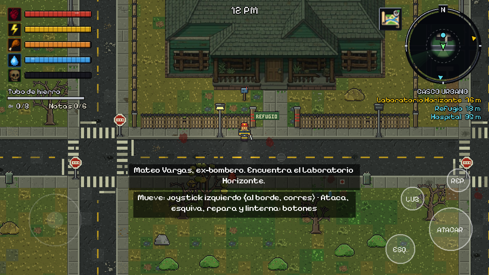
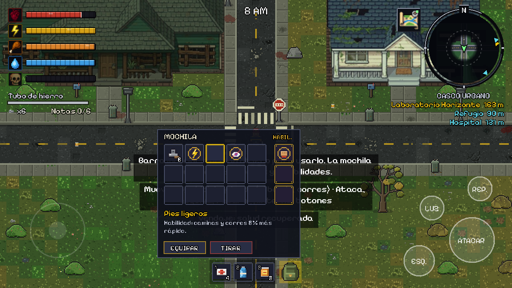

# Ashen Horizon

Juego de **acción, aventura y supervivencia en mundo abierto** con vista cenital 2D y pixel art, pensado para **móvil en horizontal**. Título provisional.

Hace 14 meses el virus **Ceniza** colapsó las ciudades; se propaga con esporas que caen con la lluvia ácida. Este prototipo cubre el **Acto I de Mateo Vargas**, ex-bombero que busca el **Laboratorio Horizonte**, donde podría estar el origen del brote.

| Día | Noche + lluvia ácida |
|---|---|
|  |  |

## Cómo ejecutarlo

1. Instala **[Godot 4.3](https://godotengine.org/download)** (versión estándar, no .NET).
2. Abre Godot → *Importar* → selecciona `project.godot` de esta carpeta.
3. Pulsa **F5** (la escena principal ya está configurada).

La primera vez Godot importa el proyecto y registra las clases; si ves errores de clases desconocidas, cierra y vuelve a abrir el proyecto.

### Controles

| Acción | Teclado (PC) | Móvil |
|---|---|---|
| Moverse | WASD / flechas | Joystick flotante en la mitad izquierda |
| Correr | Shift | Llevar el joystick al borde |
| Atacar | J / Z | Botón ATACAR |
| Esquivar | Espacio | Botón ESQUIVA |
| Reparar arma (2 chatarras) | R | Botón REPARAR |
| Linterna | F | Botón LUZ |
| Mostrar / ocultar minimapa | M | Botón del mapa (junto al minimapa) |
| Zoom del minimapa (3 niveles) | N | Tocar el minimapa |

En PC también puedes usar los botones táctiles con el mouse.

## Probarlo en GitHub Codespaces (navegador o celular)

Codespaces no tiene pantalla para el editor de Godot, así que el juego se exporta a Web y se abre en el navegador.

1. En GitHub abre el repo → **Code** → pestaña **Codespaces** → **Create codespace on main**.
2. Cuando cargue VS Code en el navegador, abre la terminal (**Ctrl + `**).
3. Ejecuta `bash tools/web.sh`. La primera vez descarga Godot y las plantillas de exportación (~1 GB); las siguientes veces tarda segundos.
4. Cuando diga *Sirviendo en el puerto 8000*, abre la pestaña **PUERTOS** y pulsa el icono del globo junto al 8000.
5. Para probarlo en el celular, en **PUERTOS** haz clic derecho en el 8000 → *Port Visibility* → **Public**, copia la dirección y ábrela en el teléfono en horizontal. Vuelve a ponerlo en *Private* al terminar.
6. Tras cambiar código: **Ctrl + C** en la terminal y vuelve a ejecutar `bash tools/web.sh`.

Haz clic en el juego antes de usar el teclado. Cuando termines, detén o elimina el codespace para no gastar tu cuota gratuita.

## Qué incluye el prototipo

- **Mateo** jugable, con sus ventajas pasivas: más vida y estamina, y más daño cuerpo a cuerpo (peor puntería). **Lena** ya está definida en `characters.gd` para cuando se agregue la selección.
- **Supervivencia:** vida, estamina, hambre, sed e infección; inventario limitado (chatarra); arma improvisada con **desgaste** y reparación.
- **Combate:** golpe cuerpo a cuerpo con aturdimiento y empuje, esquiva con invulnerabilidad breve.
- **Ruido:** correr, atacar y esquivar hacen ruido y atraen zombis. Es la base para las armas de fuego con silenciador.
- **Combate visual:** salpicaduras de sangre al golpear, charco que queda al matar y una pose de impulso al esquivar.
- **Zombis:** caminantes (lentos, peligrosos en grupo), **corredores** (ven de más lejos y alcanzan casi al jugador) y **tanque** (220 de vida, apenas retrocede). Oyen, ven en cono (más lejos si llevas linterna) y pierden el rastro.
- **Minimapa circular estilo GTA:** mapa en alta resolución (calles, edificios con puertas, zona industrial), niebla de guerra, tu posición con cono de linterna y rastro de pasos, objetivos con flechas en el borde, zombis dentro del radar con alertas pulsantes, anillo de ruido, nombre del sector y 3 niveles de zoom. Se muestra u oculta con el botón del mapa.
- **Mundo:** ciudad procedural con calles, edificios con puerta, autopista con barricadas y zona industrial al este.
- **Atmósfera:** ciclo día/noche con linterna, lluvia ácida y niebla tóxica (dañan al aire libre; los edificios protegen).
- **Refugio:** al entrar se guarda el progreso (punto de reaparición), recuperas vida y los zombis pierden tu rastro.
- **Historia:** 6 notas repartidas por el mapa y **eventos aleatorios** (estruendos que mueven a los infectados y entregas aéreas: un avión de carga cruza el cielo, suelta una caja con paracaídas y queda marcada en el minimapa).
- **Meta:** llegar al Laboratorio Horizonte.

Los **personajes y zombis** usan hojas de sprites (`assets/sprites/`) con contorno, sombreado y animaciones de reposo, caminar, correr y atacar en cuatro direcciones. Las genera `tools/gen_sprites.py` (cambia colores o formas y vuelve a ejecutarlo), o puedes abrirlas en Aseprite y pintarlas a mano respetando el tamaño de cuadro y el orden de filas. Los iconos del HUD, la fuente y las luces siguen siendo provisionales (`pixel_art.gd`).

Las **calles, aceras y el césped** tienen su propio atlas (`assets/world/terrain.png`, generado por `tools/gen_terrain.py`): asfalto con grietas, baches y huellas, aceras con bordillo, césped en cinco niveles de sequedad (de exuberante a ceniza) y escombros para las barricadas. La **calle del medio es una autopista de 4 carriles** (doble línea amarilla, líneas blancas discontinuas, flechas, cebras y líneas de pare en cada cruce) con **semáforos** (la mayoría apagados; algunos parpadean en ámbar o rojo y brillan de noche), señales de pare, límite de velocidad, peatones y carteles verdes (Horizonte / Industrial), postes de luz, autos abandonados, conos, hidrantes, basureros, alcantarillas, árboles secos, arbustos y rocas (`tools/gen_props.py`). Los autos solo bloquean los carriles exteriores: los dos del centro siempre se pueden recorrer.

Las **casas** forman un vecindario (`tools/gen_houses.py` + tu arte en `assets/houses/`): cabañas, casas, chalets y talleres industriales, con la fachada hacia la calle, caminito hasta la acera, buzón y arbustos. Cada casa tiene su techo y su interior: el techo se vuelve transparente cuando entras. El **refugio** está rodeado por un cercado de madera con alambre de púas, un portón abierto y un cartel.



El **inventario** (`inventory.gd`, `inventory_ui.gd`) tiene 3 casillas rápidas abajo (toca para usar; teclas 1-3), una mochila de 15 casillas con el botón de la derecha (tecla B) y 3 casillas de **habilidades** equipadas. Toca un objeto para seleccionarlo y luego otra casilla para moverlo, o usa Usar / Equipar / Tirar. Hay 6 habilidades (Golpe fuerte, Resistencia, Pies ligeros, Manos hábiles, Estómago fuerte, Sigilo); se aprenden con los manuales de supervivencia escondidos en las casas.




Fila superior: Mateo, Lena y los dos primeros caminantes. Fila inferior: los otros dos caminantes, los dos corredores y el tanque. Cada uno se muestra en reposo, caminando y atacando.

## Estructura

```
scenes/main.tscn        Escena principal (solo carga main.gd)
scripts/
  main.gd               Arma el juego: mundo, jugador, zombis, ciclo día/noche, clima, eventos
  world.gd              Generación procedural del mapa, colisiones y objetivos
  player.gd             Movimiento, estamina, combate, supervivencia, ruido, linterna
  zombie.gd             IA (vagar / investigar / perseguir) y variantes
  characters.gd         Datos de Mateo y Lena (estadísticas y paleta)
  hud.gd                Reloj, arma, objetivos, avisos, pantallas de fin
  stat_bars.gd          Barras pixel art con icono y animaciones (vida, estamina, hambre, sed, infección)
  minimap.gd            Minimapa circular, niebla de guerra y botón de mostrar/ocultar
  ui_font.gd            Carga la fuente pixel del juego
  touch_controls.gd     Joystick y botones táctiles
  weather.gd            Lluvia ácida y niebla tóxica
  input_setup.gd        Acciones de entrada (teclado)
  pixel_art.gd          Tiles, iconos y luces generados por código (arte provisional)
  sprite_sheets.gd      Carga las hojas de sprites y arma las animaciones
  supply_drop.gd        Entrega aérea: avión, caja y paracaídas
  houses.gd             Techos con fundido, interiores y cercado del refugio
  house_data.gd         Muros y pisos de cada casa (generado por tools/gen_houses.py)
  inventory.gd          Modelo del inventario (barra rápida, mochila, habilidades)
  inventory_ui.gd       Interfaz del inventario
  item_defs.gd          Objetos y habilidades
  street_markings.gd    Marcas viales y bordillos (cebras, líneas de carril y de pare, flechas)
  street_props.gd       Semáforos, señales, postes, autos, vegetación y manchas del suelo (colocación y colisiones)
tools/web.sh            Exporta a Web y lo sirve (para Codespaces)
tools/gen_sprites.py    Genera las hojas de sprites (requiere Pillow)
tools/gen_terrain.py    Genera el atlas de asfalto, aceras, césped y escombros (requiere Pillow)
tools/gen_houses.py     Prepara el arte de las casas y genera house_data.gd
tools/gen_fence.py      Cercado, portón, cartel y buzón
tools/gen_inventory_ui.py  Iconos y casillas del inventario
tools/gen_props.py      Genera los objetos de calle: semáforos, señales, autos, árboles... (requiere Pillow)
assets/supply/          Avión, caja y paracaídas de las entregas aéreas (originales en originales/)
assets/world/           terrain.png y props/ (objetos de calle)
assets/ui/              Iconos del HUD (vida, estamina, hambre, sed, infección, mapa); originales en assets/ui/originales
assets/sprites/         Hojas de sprites de personajes y zombis
assets/fonts/           Fuente Pixelify Sans (licencia OFL incluida)
docs/DISENO.md          Documento de diseño (historia, mapa, motor, hoja de ruta)
```

## Exportar a Android

1. En Godot: *Proyecto → Exportar → Añadir… → Android* (requiere el SDK de Android y la plantilla de exportación; la guía oficial está en la documentación de Godot).
2. La orientación ya está en **horizontal** (`window/handheld/orientation`).
3. `export_presets.cfg` y los keystores están en `.gitignore` a propósito: no los subas al repositorio.

## Hoja de ruta

Ver [docs/DISENO.md](docs/DISENO.md).

## Créditos

- Fuente **Pixelify Sans** (The Pixelify Sans Project Authors), bajo licencia SIL Open Font License (ver `assets/fonts/OFL.txt`).

## Armas, laboratorio e historia (Acto I)

- **Armas**: tubo de hierro, machete, hacha (cuerpo a cuerpo, con durabilidad), pistola y escopeta (usan `balas` / `cartuchos` del inventario). Hay armas escondidas en casas cercanas al refugio, en el hospital y en un taller.
- **Mapa**: 176x96 tiles; nueva carretera vertical y el **Laboratorio Horizonte** (compuesto cercado, 36x20 tiles) al noreste. El jugador nace en el refugio y ahí no aparecen zombis.
- **Hitboxes de interiores**: `tools/audit_houses.py` comprueba que el círculo del jugador pueda recorrer cada interior y ajusta los muebles (`python3 tools/gen_houses.py` regenera todo). El laboratorio se dibuja con `tools/gen_lab.py`, así arte y colisiones coinciden.
- **Historia**: radio de Lena → hospital (Tarjeta Horizonte) → puerta del laboratorio → terminal «Lote H-7» → gancho para el Acto II.

## Más edificios (ciudad)

Generados por código en `tools/gen_buildings.py` (arte y colisiones salen de la misma lista de muebles; `gen_houses.py` los integra y verifica que se puedan recorrer):
- **Supermercado**, **comisaría** (celdas y armero), **iglesia**, **tienda**, **casita** y **apartamentos** en el casco urbano y los barrios.
- **Cancha** de fútbol cercada en la zona industrial.
- **Base militar** (cuartel con literas y armero, patio de concreto cercado, muchos infectados) al sureste: tiene el **fusil de asalto** y munición.

## Mapa ampliado y máscara antigás

- Mapa de 224x120 tiles: nueva calle al este, fila de manzanas al sur y la **Zona Cero** (extremo este, contaminada, con más tanques).
- **Hospital** de verdad (camas, recepción, cruz roja en el techo): ahí está la Tarjeta Horizonte.
- **Máscara antigás**: aparece solo en el cuartel de la base militar. Mientras la lleves en la mochila no recibes daño de la lluvia ácida ni del aire tóxico.

## Acto II: «Suero H-7»

1. Terminal del laboratorio → se revela que Mateo es el sujeto de control (Lote H-7).
2. Base militar: llave del búnker (y máscara antigás).
3. Zona Cero (extremo este): el búnker H-7 se abre con la llave; en su terminal está el suero.
4. Al tomarlo suena la alarma y llega una horda; hay que volver al refugio con el suero.

Los edificios generados por código llevan texturas de material (ladrillo, tablones, concreto), decoración interior, sombra proyectada en el suelo y acabado con ruido/luz (`tools/gen_polish.py`). Buzones y arbustos ya no tienen colisión.

## Música y botín visible

- `scripts/music.gd`: 4 pistas en `assets/audio/music/` que suenan al azar con silencios de 60–150 s entre una y otra (nunca seguidas ni repetidas), con fundido de entrada y salida.
- El botín se dibuja sobre el interior de los edificios y tiene un brillo que late, para verlo en cualquier suelo.

## Música y botín visible

- `scripts/music.gd`: música de fondo (`assets/audio/music/`). Suena una pista al azar cada 60–150 s de silencio (la primera a los 15 s), nunca la misma dos veces seguidas, con fundido de entrada y salida.
- El botín dentro de los edificios se dibuja sobre el interior y tiene un brillo que late.

## Pantalla de muerte y calidad de edificios

- Pantalla de muerte: fundido rojo con viñeta, título con goteo de sangre, causa de la muerte, tiempo sobrevivido, zombis abatidos, notas, consejo aleatorio y botón pulsante para reaparecer.
- Edificios: ampliación Scale2x (diagonales suaves), sombras de muebles, alero con sombra, canalones, farol y felpudo en la puerta, techos a dos aguas con luz/sombra y chimenea.


## Sonido y pantalla de inicio

- **Efectos de sonido** (48 archivos en `assets/audio/sfx/`): pasos, golpes, disparos por arma, recoger, curar/comer/beber, puertas y terminales, zombis (gruñido, golpe, ataque, muerte), lluvia en bucle, alarma, UI, herida y muerte. Se sintetizan con `python3 tools/gen_sfx.py` (numpy/scipy).
- **Para usar tus propios sonidos**: pon un archivo con el mismo nombre (`.ogg` o `.wav`) en `assets/audio/sfx/`; `scripts/sfx.gd` busca primero `.ogg`.
- API: `Sfx.play("pickup")`, `Sfx.play_at("zombie_hurt", pos)`, `Sfx.pick("step", 4)`, `Sfx.loop("rain_loop", true)`.
- **Pantalla de inicio** (`scenes/title.tscn`, ahora escena principal): logo, ciudad en ruinas bajo la lluvia, menú JUGAR / CONTROLES / CRÉDITOS, táctil y con Enter/Espacio.

## Menú de pausa

Engranaje arriba a la derecha (junto al mapa) o tecla Esc: pausa el juego y permite ajustar volumen general/música/efectos (se guarda), ver los controles, volver al último refugio si te atascas y salir a la pantalla de inicio (pide confirmar). Código: `scripts/pause_menu.gd`.

## Refugio ampliado y objetivos

- El refugio ocupa un bloque propio (chalet + patio cercado de 25×21 tiles, sin árboles ni obstáculos dentro, listo para un futuro huerto).
- La tarjeta Horizonte aparece siempre en una de las casas cercanas al refugio. Al inicio sale el mensaje fijo «Investiga la zona en busca de la tarjeta de acceso».
- La lista y el minimapa muestran solo el refugio; el laboratorio aparece al tener la tarjeta. Hospital y base militar ya no muestran distancia (la base y el búnker solo salen cuando son el objetivo principal).

## Huerto del refugio y casas más exploradas

- **Huerto** (`scripts/farm.gd`): 8 parcelas junto a la casa del refugio. Camina sobre una parcela vacía con **semillas** en la mochila para plantar; brota y madura sola (~90 s) y al pisarla madura cosechas 2 de comida (y a veces una semilla). Las semillas están en el refugio y en tiendas, supermercados y casas. Sonidos nuevos: `plant` y `harvest` (regenerables con `python3 tools/gen_sfx.py --only plant,harvest` sin pisar archivos reemplazados a mano).
- **Hitbox de casas**: chalet, casa y cabaña tenían habitaciones dibujadas que eran muros sólidos; ahora se pueden recorrer todas (puertas entre habitaciones y muebles nuevos). Ajustado en `LAYOUT` de `tools/gen_houses.py`.
- **Menú de pausa**: barras de volumen centradas y con la perilla dentro de la barra.

## Mejoras del refugio (mesa, botiquín, generador)

En el patio cercado, al sur de la casa (`scripts/refuge.gd`, panel en `scripts/station_menu.gd`). Junto a cada puesto aparece el botón **USAR** arriba al centro (tecla E en PC); el panel pausa el juego.
- **Mesa de trabajo**: fabrica vendaje (3 chatarra), balas x6 (5), cartuchos x3 (6), combustible (6) y semillas x3 (2).
- **Botiquín ampliable**: guarda vendajes como cargas (3/6/10 según el nivel; ampliar cuesta 6 y 10 de chatarra); cada carga cura 40/50/60 y baja la infección.
- **Generador**: gasta combustible (un bidón ≈ 100 s; depósito máximo ≈ 5 min). Encendido: luces, cura x1,4 de día y x1,8 de noche. De noche, sin generador, el refugio está **frío**: cura x0,35 y hambre/sed 1,7x más rápidas. El combustible se encuentra en talleres, tiendas y el refugio, o se fabrica.
- Objeto nuevo: **Combustible** (bidón). Sonidos nuevos: `craft`, `gen_start`, `gen_stop`, `gen_loop`.

### Farol del huerto
Un poste con luz cálida ilumina las parcelas de noche; cada 7–14 s la luz parpadea unos instantes (`scripts/farm.gd`).

### Casa del refugio (diseño propio)
La casa del refugio (`refugio`, 14x16 tiles) se dibuja por código en `tools/gen_buildings.py` (cabaña de madera con paneles solares, lona, antena y chimenea). Dentro: cama, estufa, cocina, sofá, mesa, **mesa de trabajo, botiquín y cofre** (los puestos van dentro de la casa). El **cofre** guarda hasta 60 unidades de recursos (vendajes, comida, agua, chatarra, semillas, combustible y munición). El **generador** queda en el patio delantero.
Luces interiores: se encienden de **18:00 a 6:00**; con el generador encendido brillan más y más claras. El techo no se ilumina desde dentro (`light_mask`). Regenerar el arte: `python3 tools/gen_houses.py`.
