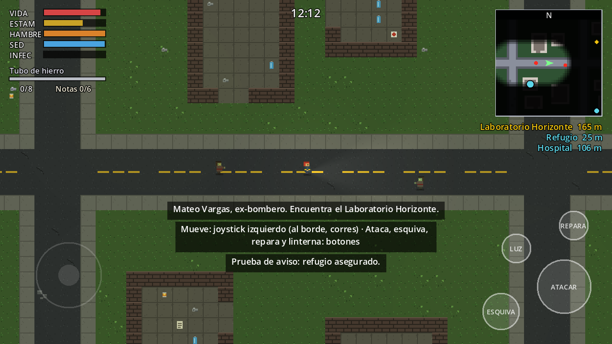
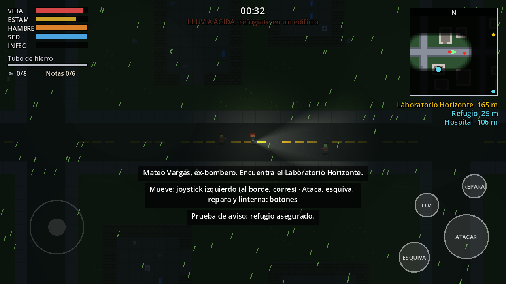
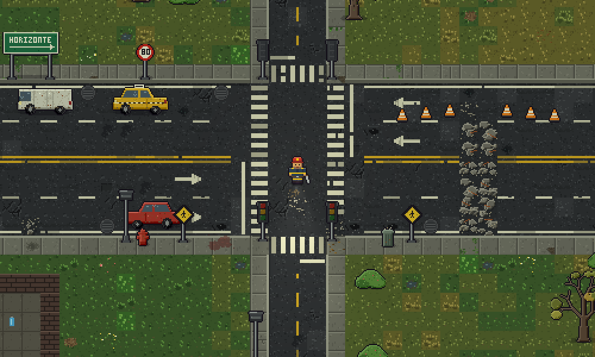
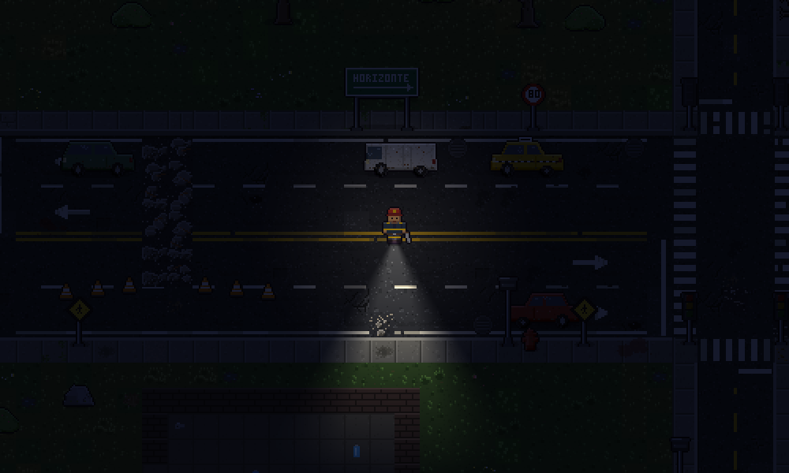
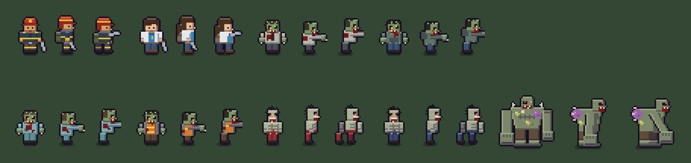

# Ashen Horizon

Juego de **acción, aventura y supervivencia en mundo abierto** con vista cenital 2D y pixel art, pensado para **móvil en horizontal**. Título provisional.

Hace 14 meses el virus **Ceniza** colapsó las ciudades; se propaga con esporas que caen con la lluvia ácida. Este prototipo cubre el **Acto I de Mateo Vargas**, ex-bombero que busca el **Laboratorio Horizonte**, donde podría estar el origen del brote.

| Día | Noche + lluvia ácida |
|---|---|
|  |  |

## Cómo ejecutarlo

1. Instala **[Godot 4.3](https://godotengine.org/download)** (versión estándar, no .NET).
2. Abre Godot → *Importar* → selecciona `project.godot` de esta carpeta.
3. Pulsa **F5** (la escena principal ya está configurada).

La primera vez Godot importa el proyecto y registra las clases; si ves errores de clases desconocidas, cierra y vuelve a abrir el proyecto.

### Controles

| Acción | Teclado (PC) | Móvil |
|---|---|---|
| Moverse | WASD / flechas | Joystick flotante en la mitad izquierda |
| Correr | Shift | Llevar el joystick al borde |
| Atacar | J / Z | Botón ATACAR |
| Esquivar | Espacio | Botón ESQUIVA |
| Reparar arma (2 chatarras) | R | Botón REPARAR |
| Linterna | F | Botón LUZ |
| Mostrar / ocultar minimapa | M | Botón del mapa (junto al minimapa) |
| Zoom del minimapa (3 niveles) | N | Tocar el minimapa |

En PC también puedes usar los botones táctiles con el mouse.

## Probarlo en GitHub Codespaces (navegador o celular)

Codespaces no tiene pantalla para el editor de Godot, así que el juego se exporta a Web y se abre en el navegador.

1. En GitHub abre el repo → **Code** → pestaña **Codespaces** → **Create codespace on main**.
2. Cuando cargue VS Code en el navegador, abre la terminal (**Ctrl + `**).
3. Ejecuta `bash tools/web.sh`. La primera vez descarga Godot y las plantillas de exportación (~1 GB); las siguientes veces tarda segundos.
4. Cuando diga *Sirviendo en el puerto 8000*, abre la pestaña **PUERTOS** y pulsa el icono del globo junto al 8000.
5. Para probarlo en el celular, en **PUERTOS** haz clic derecho en el 8000 → *Port Visibility* → **Public**, copia la dirección y ábrela en el teléfono en horizontal. Vuelve a ponerlo en *Private* al terminar.
6. Tras cambiar código: **Ctrl + C** en la terminal y vuelve a ejecutar `bash tools/web.sh`.

Haz clic en el juego antes de usar el teclado. Cuando termines, detén o elimina el codespace para no gastar tu cuota gratuita.

## Qué incluye el prototipo

- **Mateo** jugable, con sus ventajas pasivas: más vida y estamina, y más daño cuerpo a cuerpo (peor puntería). **Lena** ya está definida en `characters.gd` para cuando se agregue la selección.
- **Supervivencia:** vida, estamina, hambre, sed e infección; inventario limitado (chatarra); arma improvisada con **desgaste** y reparación.
- **Combate:** golpe cuerpo a cuerpo con aturdimiento y empuje, esquiva con invulnerabilidad breve.
- **Ruido:** correr, atacar y esquivar hacen ruido y atraen zombis. Es la base para las armas de fuego con silenciador.
- **Combate visual:** salpicaduras de sangre al golpear, charco que queda al matar y una pose de impulso al esquivar.
- **Zombis:** caminantes (lentos, peligrosos en grupo), **corredores** (ven de más lejos y alcanzan casi al jugador) y **tanque** (220 de vida, apenas retrocede). Oyen, ven en cono (más lejos si llevas linterna) y pierden el rastro.
- **Minimapa circular estilo GTA:** mapa en alta resolución (calles, edificios con puertas, zona industrial), niebla de guerra, tu posición con cono de linterna y rastro de pasos, objetivos con flechas en el borde, zombis dentro del radar con alertas pulsantes, anillo de ruido, nombre del sector y 3 niveles de zoom. Se muestra u oculta con el botón del mapa.
- **Mundo:** ciudad procedural con calles, edificios con puerta, autopista con barricadas y zona industrial al este.
- **Atmósfera:** ciclo día/noche con linterna, lluvia ácida y niebla tóxica (dañan al aire libre; los edificios protegen).
- **Refugio:** al entrar se guarda el progreso (punto de reaparición), recuperas vida y los zombis pierden tu rastro.
- **Historia:** 6 notas repartidas por el mapa y **eventos aleatorios** (estruendos que mueven a los infectados, cajas de suministros marcadas en el minimapa).
- **Meta:** llegar al Laboratorio Horizonte.

Los **personajes y zombis** usan hojas de sprites (`assets/sprites/`) con contorno, sombreado y animaciones de reposo, caminar, correr y atacar en cuatro direcciones. Las genera `tools/gen_sprites.py` (cambia colores o formas y vuelve a ejecutarlo), o puedes abrirlas en Aseprite y pintarlas a mano respetando el tamaño de cuadro y el orden de filas. Los iconos del HUD, la fuente y las luces siguen siendo provisionales (`pixel_art.gd`).

Las **calles, aceras y el césped** tienen su propio atlas (`assets/world/terrain.png`, generado por `tools/gen_terrain.py`): asfalto con grietas, baches y huellas, aceras con bordillo, césped en cinco niveles de sequedad (de exuberante a ceniza) y escombros para las barricadas. La **calle del medio es una autopista de 4 carriles** (doble línea amarilla, líneas blancas discontinuas, flechas, cebras y líneas de pare en cada cruce) con **semáforos** (la mayoría apagados; algunos parpadean en ámbar o rojo y brillan de noche), señales de pare, límite de velocidad, peatones y carteles verdes (Horizonte / Industrial), postes de luz, autos abandonados, conos, hidrantes, basureros, alcantarillas, árboles secos, arbustos y rocas (`tools/gen_props.py`). Los autos solo bloquean los carriles exteriores: los dos del centro siempre se pueden recorrer.






Fila superior: Mateo, Lena y los dos primeros caminantes. Fila inferior: los otros dos caminantes, los dos corredores y el tanque. Cada uno se muestra en reposo, caminando y atacando.

## Estructura

```
scenes/main.tscn        Escena principal (solo carga main.gd)
scripts/
  main.gd               Arma el juego: mundo, jugador, zombis, ciclo día/noche, clima, eventos
  world.gd              Generación procedural del mapa, colisiones y objetivos
  player.gd             Movimiento, estamina, combate, supervivencia, ruido, linterna
  zombie.gd             IA (vagar / investigar / perseguir) y variantes
  characters.gd         Datos de Mateo y Lena (estadísticas y paleta)
  hud.gd                Reloj, arma, objetivos, avisos, pantallas de fin
  stat_bars.gd          Barras pixel art con icono y animaciones (vida, estamina, hambre, sed, infección)
  minimap.gd            Minimapa circular, niebla de guerra y botón de mostrar/ocultar
  ui_font.gd            Carga la fuente pixel del juego
  touch_controls.gd     Joystick y botones táctiles
  weather.gd            Lluvia ácida y niebla tóxica
  input_setup.gd        Acciones de entrada (teclado)
  pixel_art.gd          Tiles, iconos y luces generados por código (arte provisional)
  sprite_sheets.gd      Carga las hojas de sprites y arma las animaciones
  street_markings.gd    Marcas viales y bordillos (cebras, líneas de carril y de pare, flechas)
  street_props.gd       Semáforos, señales, postes, autos, vegetación y manchas del suelo (colocación y colisiones)
tools/web.sh            Exporta a Web y lo sirve (para Codespaces)
tools/gen_sprites.py    Genera las hojas de sprites (requiere Pillow)
tools/gen_terrain.py    Genera el atlas de asfalto, aceras, césped y escombros (requiere Pillow)
tools/gen_props.py      Genera los objetos de calle: semáforos, señales, autos, árboles... (requiere Pillow)
assets/world/           terrain.png y props/ (objetos de calle)
assets/ui/              Iconos del HUD (vida, estamina, hambre, sed, infección, mapa); originales en assets/ui/originales
assets/sprites/         Hojas de sprites de personajes y zombis
assets/fonts/           Fuente Pixelify Sans (licencia OFL incluida)
docs/DISENO.md          Documento de diseño (historia, mapa, motor, hoja de ruta)
```

## Exportar a Android

1. En Godot: *Proyecto → Exportar → Añadir… → Android* (requiere el SDK de Android y la plantilla de exportación; la guía oficial está en la documentación de Godot).
2. La orientación ya está en **horizontal** (`window/handheld/orientation`).
3. `export_presets.cfg` y los keystores están en `.gitignore` a propósito: no los subas al repositorio.

## Hoja de ruta

Ver [docs/DISENO.md](docs/DISENO.md).

## Créditos

- Fuente **Pixelify Sans** (The Pixelify Sans Project Authors), bajo licencia SIL Open Font License (ver `assets/fonts/OFL.txt`).
